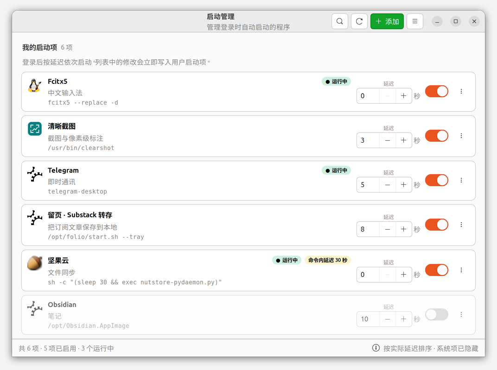

# 启动管理 / Startup Manager

一个面向 GNOME 的小型登录启动项管理工具。它把你所有的 XDG autostart 项目整理成一张清晰的列表，可以直接开关、调整延迟、添加或编辑启动命令，并查看哪些程序当前正在运行。



## 功能

- **清晰列表**：按“已启用优先、实际启动延迟从早到晚”排列，一眼看出登录后谁先启动。
- **一键开关**：每个启动项都有开关；修改立即写入桌面文件，下次登录生效。
- **延迟调节**：每项独立设置 0–600 秒延迟，直接写入 `X-GNOME-Autostart-Delay`。
- **识别命令内延迟**：像 `sh -c "(sleep 30 && exec ...)"` 这样的命令会显示“命令内延迟 30 秒”，避免重复计算。
- **运行状态**：通过进程命令行匹配，在列表中标出正在运行的程序；可在设置中关闭。
- **添加 / 编辑 / 删除**：为任意程序创建新的登录启动项，填写名称、命令、备注、图标和延迟。
- **系统项保护**：默认只显示 `~/.config/autostart` 中的个人启动项；打开“显示系统启动项”后会列出 `/etc/xdg/autostart`，但系统文件永远不被修改，调整时会自动创建用户覆盖。
- **外部修改自动刷新**：其他程序或手动编辑了 autostart 文件时，列表会自动更新。
- **设置持久化**：显示系统项、运行状态、刷新间隔、默认延迟和排序方式保存在 `~/.config/startup-manager/settings.json`。

## 安装

依赖 GTK 3 的 Python 绑定（Ubuntu 通常已安装）：

```bash
sudo apt install python3-gi gir1.2-gtk-3.0
```

在项目目录中安装到当前用户：

```bash
/usr/bin/python3 install.py
```

之后可以在应用菜单搜索 **启动管理**，或直接运行：

```bash
~/.local/bin/startup-manager
```

也可以不安装，直接运行：

```bash
/usr/bin/python3 startup_manager.py
```

安装脚本只写入 `~/.local/`，不会修改系统目录。源码移动后重新运行 `install.py` 即可更新入口。

## 使用

- 顶部的搜索按钮可以按名称、备注或命令过滤。
- 每个条目右侧的“延迟”就是登录后的额外等待时间；`0` 表示立即。
- 开关和延迟修改后立即生效，不需要重启程序。
- 条目最右侧的 `⋯` 菜单可以编辑、复制命令、在文件夹中显示或删除。
- 系统启动项需要先在 **设置 → 显示系统启动项** 中打开；对系统项做任何调整都会在 `~/.config/autostart` 中创建同名用户覆盖，原系统文件保持不变。
- 删除用户覆盖后，系统项会恢复系统默认行为。

## 延迟是如何工作的

延迟写入桌面文件的 `X-GNOME-Autostart-Delay` 字段，由 GNOME 会话在登录时执行。Ubuntu 的 GNOME 会话包含该支持；KDE、XFCE 等桌面可能忽略这个字段。

如果程序自身的启动命令已经包含 `sleep`，列表会单独显示“命令内延迟 N 秒”。这部分延迟由命令自己执行，和这里设置的原生延迟会叠加。

## 文件位置

- 个人启动项：`~/.config/autostart/*.desktop`
- 系统启动项：`/etc/xdg/autostart/*.desktop`（只读展示）
- 本程序设置：`~/.config/startup-manager/settings.json`

本程序不会写入 `/etc`，不会删除系统文件，也不会改动与启动项无关的 `[Desktop Action]` 等内容。

## 运行状态说明

“运行中”标记来自对 `/proc` 的启发式匹配：解析 `Exec` 中的程序名、路径、脚本 `exec` 目标，以及 flatpak/snap 启动方式。它只会在找到匹配时显示标记；识别不出的程序不会被误标为已停止。

## 卸载

```bash
rm ~/.local/bin/startup-manager \
   ~/.local/share/applications/org.alex.StartupManager.desktop \
   ~/.local/share/icons/hicolor/scalable/apps/org.alex.StartupManager.svg
```

只会删除本程序的入口和图标；`~/.config/autostart` 中的启动项不会被删除。

## 测试

```bash
/usr/bin/python3 -m unittest discover -s tests -v
# GTK 界面测试需要显示环境
xvfb-run -a /usr/bin/python3 -m unittest discover -s tests -v
```
